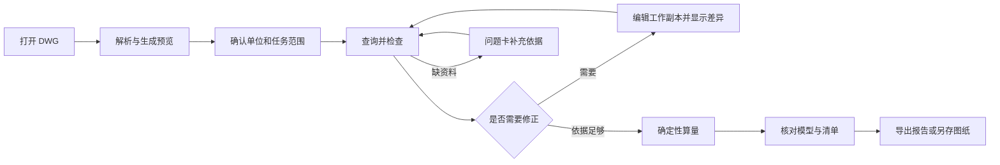
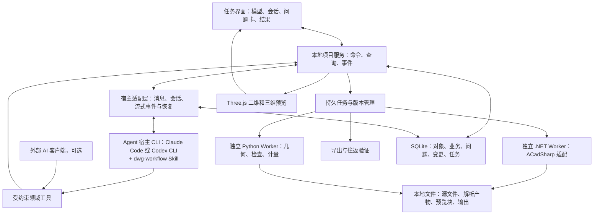

# 筑材智算 DWG AI 工作流方案

| 文档项 | 内容 |
| --- | --- |
| 版本 | V1.4 |
| 日期 | 2026-10-27 |
| 用途 | 产品评审、技术设计、开发拆解与验收 |
| 覆盖范围 | DWG 加载、查询、检查、编辑、算量与交互式预览 |
| 推荐形态 | 单机本地引擎、任务式界面、一个 Agent 与入口 Skill |
| 实施状态 | 方案设计；本文不表示功能已开发或验收 |

> 实施进度（2026-10-28）：已形成受支持二维子集的可运行闭环；完整规划尚未全部验收。实际能力、验证证据与剩余缺口见 [实施进度与验收](docs/实施进度与验收.md)。

V1.1 修订：修正单位变化的计量验收规则，补齐修订几何快照、对象身份及坐标转换契约，并同步到接口、工作包和验收任务。

V1.2 修订：明确首期不自研 Agent 运行时，宿主采用 Claude Code 或 Codex CLI 之一并在 P0 完成选型验证；补充账号、数据流与离线边界，并同步到架构、P0 和工作包。

V1.3 修订：增加天正来件与 T3 兼容副本策略，将本目录四份综合楼附房 DWG 纳入 P0，明确转换来源、对象能力、构件语义与编辑交付边界。

V1.4 修订：补齐工作台与 Agent 宿主的会话桥接、DWG 依赖交付包及迁移验收、MINSERT 阵列实例身份与操作边界；数据发送按任务和配置选择，不再强制原文件不出网，并同步工作包与验收任务。

## 方案摘要

建设一套围绕工程文件完成任务的 AI 工作流。用户打开 DWG，通过自然语言和图形选择表达目标；Agent 调用受约束的领域工具，自动推进解析、查询、检查、修正与算量；用户在交互预览中核对关键范围与依据，导出新图纸版本和可追溯清单。

推荐复用原项目 React/TypeScript/Three.js 前端，采用 Node.js 本地项目服务、ACadSharp .NET Worker、Python 几何工具链及 SQLite/本地文件存储。首期先验证二维 DWG 和受支持图元，逐步开放真实三维与实体能力。

项目结构化状态是事实依据，几何和规则工具生成数量，Skill 封装工作方法，Agent 负责理解目标及选择工具。业务参数修改与真实 CAD 图元编辑分别表达，共用版本、变更和重算机制。

首期成功标准：非技术用户可通过统一入口打开文件、定位问题、完成一次明确修改和有依据的算量；经验证的文档能够另存 DWG；关闭后可以恢复项目；未解析或无法计算的内容在界面和交付物中持续可见。

### 阅读导航

- §1—3：目标、现状与用户流程。
- §4—8：架构、引擎、数据模型与领域工具。
- §9—14：查询、检查、编辑、算量、预览和运行机制。
- §15—16：实施阶段、验收与首个演示。
- §17—20：界面方案、接口示例、开发工作包与交付清单。

## 1. 产品目标与首期边界

用户打开一个 DWG，用一句话提出任务，系统自动解析、查询并定位对象，按需检查、编辑、重算，最终交付可追溯的图纸版本、工程量清单和问题清单。

建议首期基线：**单机本地引擎 + 任务式 Web 界面 + 一个 Agent + 一个入口 Skill + 领域工具**。复用原项目 React/TypeScript/Three.js 基础，接入已验证过读取的 ACadSharp 路径。Agent 不自研运行时，宿主采用 Claude Code 或 Codex CLI 之一（见 §13）。最终给小白用户交付统一启动器，解析进程与 Agent 宿主由应用统一启动，模型账号和用量遵循宿主的订阅或 API 方式。

首批输入包括原仓库三份 AC1018 DWG，以及本目录 `2026-10/` 下四份综合楼附房 DWG，补充已知尺寸与编辑往返测试样本。天正来件首期采用“原生对象能力探测 → 必要时由提供方导出 T3 兼容副本 → 核验后计量”的路径（§5.1），不将通用未知对象提示作为适配完成。首期覆盖二维图元、图层、块与属性、长度面积和有明确参数依据的体积；三维网格按可验证方法开放。原生三维实体、复杂代理对象和完整建筑语义按适配器能力扩展。

“交互式模型预览”包含真实二维图纸视图；文件确有可显示三维几何时开放三维视图。二维图纸加厚度生成的挤出预览标为“参数推算模型”，与原文件中已有三维实体分别显示。

### 六项能力的交付定义

| 能力 | 用户能完成的事 | 完成依据 |
| --- | --- | --- |
| 加载 | 打开 DWG，看到已解析内容及未解析范围，重启可恢复 | 文件版本、导入记录、对象索引、预览产物持久化 |
| 查询 | 按图层、类型、文字、块属性、范围和业务分类找对象，结果可高亮 | 结构化筛选、分页、冻结选择集和来源 |
| 检查 | 检查单位、坐标、图元与轮廓等问题，逐项定位 | 对应检查器实际执行、证据与受影响范围 |
| 编辑 | 修改已支持的图元/属性或算量参数，查看差异、撤销并重算 | 统一变更服务、工作修订、图纸另存验收 |
| 算量 | 长度、净面积、数量及有依据的体积汇总 | 确定性算法、单位、公式、扣减和缺项 |
| 交互预览 | 缩放、平移、选择、高亮、隔离、图层开关、测量；三维场景支持旋转 | 对象映射与前后端版本一致，不能仅返回截图 |

## 2. 当前基础和缺口

原仓库 `/Users/zhangjunqing/git-bus/zhu-suan` 已有只读 CAD 探针，固定 ACadSharp 3.8.30、ezdxf 1.4.5，在 macOS arm64 上验证了三份 DWG 和三份 DXF 的对象索引、图层及部分 LINE 源坐标。

仓库记录的 DWG 模型空间实体数分别为 6,155、979、41,487。总图出现 6 个 TCH_COORD 未知实体；单体中有 2 个 REGION；现有同名 DXF 与 DWG 有对象和图层差异。模型空间记录数不等于展开后的构件数，当前资料也没有证明面积、体积、完整显示或 DWG 写回正确。

本目录新增来件如下，版本仅按文件头核对，尚未运行对象解析或几何/语义验收：

| 文件（位于 `2026-10/`） | DWG 头版本 | 当前已知与待核验项 |
| --- | --- | --- |
| 综合楼附房建筑_t3.dwg | AC1018 | 文件名提示 T3 导出；转换来源、残留自定义对象与构件语义待核验 |
| 综合楼附房结构_t3.dwg | AC1018 | 文件名提示 T3 导出；转换来源、残留自定义对象与构件语义待核验 |
| 综合楼附房电气.dwg | AC1024 | 未带 `_t3`；生成软件、对象类型及是否需要兼容导出待核验 |
| 综合楼附房给排水.dwg | AC1018 | 未带 `_t3`；生成软件、对象类型及是否需要兼容导出待核验 |

这四份文件不能统称为“四份 T3 文件”。`_t3` 是来源线索，不能单凭命名判定已完成转换；天正对象版本与 AC1018/AC1024 等 DWG 容器版本分别记录。现有 TCH_COORD 记录和这批来件足以要求专门兼容策略，但尚不能据此断言墙、门窗已大面积缺失或可算。

现有前端 `parse-model-file.ts` 只接了 GLB/glTF、OBJ、FBX 浏览器预览；`ModelViewer.tsx` 的选中关联依赖 `userData.elementId`。因此本次是新增 DWG 工具链和真实对象联动，不能将演示模型已有交互当作 DWG 能力。

依据：原仓库 `docs/CAD开源解析样本验证.md`、`docs/几何与DWG处理技术规划.md`、`tools/cad-probe/README.md` 及相关源码。本次没有重新运行这些探针。

## 3. 用户看到的流程



打开文件后先展示真实解析状态和已经可用的内容，允许浏览已解析部分。单位不明时仍可查看，但依赖真实尺寸的计量和编辑被明确标记为待校准。

用户可直接说：

> 打开厂房图纸，检查影响楼板混凝土算量的问题，先显示范围和依据。

Agent 自动查询图层、块与候选轮廓，生成可定位的问题组。若图纸缺少可靠分类，先提供“候选楼板轮廓”，不能把图层名或文字匹配直接当作已确认楼板。

用户继续说：

> 当前选中的轮廓按一层楼板计，厚度按图纸说明取 150mm，材料 C30，排除我标出的洞口。

系统冻结实际成员与依据，修改业务参数，验证轮廓和洞口，再试算和展示结果。图纸说明未实际提供时，来源记为“用户陈述”，不能声称已经核对图纸。

每一张问题卡包含：问题、影响范围、定位按钮、处理表单、处理后的变化。系统按确定范围分组收集资料，用户可以展开成员、排除例外，无需逐对象重复对话。

发现未支持的天正/其他专业自定义对象时，问题卡提供“添加兼容副本”入口，天正来件明确标注 T3 导出要求，其他专业对象按其源软件可用的兼容路径处理。入口展示提供方导出说明、当前阻塞范围及转换核验状态。副本导入后进入对照核验，再切换任务依据；不要求用户逐个猜测未知对象的业务含义。

## 4. 总体架构



建议本地项目服务采用 TypeScript/Node.js，复用现有前端类型；Python 承担几何工具链入口；ACadSharp 由独立 .NET 进程封装。Node 不直接保存海量网格，进程之间传产物引用、小型结构化消息和任务事件。

首期不要求 Dify、n8n、Redis、云数据库或多人服务。SQLite 和本地文件支撑单机任务与项目恢复；以后确需可视化后台编排，再增加适配，不改变领域工具契约。

同一套工具先通过本地服务给应用使用，并包装为 MCP 供 Agent 宿主 CLI（Claude Code 或 Codex CLI）调用。宿主适配层负责工作台到 Agent 的消息提交，以及回复、工具状态和宿主交互请求的回传；MCP 负责 Agent 到领域工具的调用，两条链路分别验收（§13.2）。Skill 不直接访问数据库，也不靠聊天历史保存项目状态。

## 5. 解析、写入与几何引擎选择

| 模块 | 推荐基线 | 必须验证的边界 |
| --- | --- | --- |
| DWG 读取 | ACadSharp .NET Worker | 目标版本、对象类型、未知记录、图层/块/实例/变换完整性 |
| 天正来件兼容 | 原生对象探测；必要时由提供方使用源软件导出 T3 兼容副本 | 原生/代理/转换后对象分别验收；转换来源、残留对象、语义和交付边界见 §5.1 |
| DWG 写入 | ACadSharp DwgWriter 的受支持子集 | 不改即另存、目标编辑、未改内容保持、独立 CAD 打开核对 |
| DXF 辅助 | ezdxf | 用于直接 DXF、对照、支持范围内的派生输出，不作为默认无损中转 |
| 二维几何 | Python + NumPy + Shapely | 曲线离散容差、局部平面、闭合、洞口、交并与实例变换 |
| 网格检查 | 按真实需要增加 trimesh | 网格来源、变换、封闭性、自交/重叠和有效体积 |
| 三维 DWG 实体 | 独立后续适配；必要时评估 ODA/RealDWG | 能读记录、能显示、能测量、能布尔/编辑四项分别验收 |
| 交互预览 | 复用 Three.js，新增 CAD 图元适配和对象索引 | 二维图元、文字、块、拾取与高亮映射 |

ACadSharp 官方声明读写 DWG/DXF 及修改图元/表记录，版本矩阵列有读写差异，例如 AC1021 的 DWG 写入未列为支持。实施时固定实际依赖版本，并逐对象验收，不根据“支持 DWG”推导任意文档可保真重写。[ACadSharp 官方说明](https://domcr.github.io/ACadSharp/index.html)、[官方仓库](https://github.com/DomCR/ACadSharp)

ezdxf 核心处理 DXF，官方明确不提供完整 ACIS 内核；读取 ACIS 载荷不等于任意三维实体可编辑和计算。[ezdxf](https://ezdxf.readthedocs.io/en/stable/)、[ACIS 限制](https://ezdxf.readthedocs.io/en/stable/acis.html)

开源适配器不能覆盖真实项目的必需对象或保真另存时，保留项目状态和工具接口，替换对应 CAD 后端。ODA Drawings 与 RealDWG 为可评估商业路线，仍要单独验证对象和几何能力；当前 RealDWG 2027 官方平台要求列 Windows 11。[ODA Drawings](https://www.opendesign.com/products/drawings)、[RealDWG](https://aps.autodesk.com/developer/overview/realdwg-api)

### 5.1 天正对象与 T3 兼容副本策略

**首期采用的路径：** 先统计原生自定义类名、代理对象、基础图元和未支持范围。对当前适配器不能处理、且影响任务的天正对象，要求提供方在能正确打开原图的源软件中导出 T3 兼容 DWG，并同时提供原始文件及必要的外参、字体/填充依赖。T3 按天正兼容导出版本记录，目标 DWG 容器版本另按适配器能力选择。其他 CAD 厂商的转换功能可作为备选，但须单独验证软件版本、运行平台、授权和转换结果，首期不依赖在本地 Worker 内自动调用天正插件。[中望官方导出说明](https://forum.zwsoft.cn/archives/83660)、[浩辰官方转换说明](https://www.gstarcad.com/help/DWG%20FastView_zh-CN/detail/Documentation_transfer/tenshin_conversion.html?labelId=&pageType=list&searchKeywords=)

**原图和副本分别保存：** 导出副本建立新的 DrawingVersion，使用转换记录关联原文件与副本指纹、软件/版本、天正目标版本、DWG 版本、导出范围/选项、时间及核验依据。未提供原图或无法证明同一修订时，来源与转换完整性记为未核验，不能补造对应关系。原图和副本属于同一任务的替代依据，不作为两个独立专业模型叠加计量；任务切换依据时冻结新选择集并重算。转换可能改变 handle 和对象粒度，只在证据足够时建立对象对应；其余业务/轮廓引用重新确认，不按相似位置或同名 handle 静默迁移。

**能力矩阵单列以下条目：** 每项绑定实际软件/适配器版本、文件与对象类型，分别填写读记录、显示、查询/定位、业务分类、几何计量、图元编辑和完整另存的状态与证据，不能只给一个“支持天正”的布尔值。

| 条目 | 首期处理与验收边界 |
| --- | --- |
| 原生 TCH_COORD 等标注类 | 核验具体类名与用途；显示/坐标读取能力单独验收，不能据此推导墙、门窗已支持 |
| 原生墙、门窗等专业对象 | 从样本确认实际类名、数量及任务影响；未验证前不声明分类、关联、尺寸提取、计量或专业对象编辑能力 |
| 代理图形或缓存显示 | 仅在适配器实际实现时提供定位/预览；可显示不等于已取得可计算几何、构件属性或可编辑原生对象 |
| T3 兼容副本中的基础图元/块 | 按转换后的实际图元验收显示、几何及编辑；构件分类、范围、参数与关联仍须独立确认 |
| T3 中残留自定义/代理对象 | 继续列出类名、影响范围及缺项；重新正确导出或换后端复验，不因文件名含 `_t3` 放行 |

**转换核验与语义边界：** P0 优先取得同一修订的“原生天正—T3 副本”配对样本，在能正确显示原图的独立 CAD 环境核对关键墙线、门窗、文字/尺寸、已知长度/闭合面积，以及单位、外参、图层和布局。检查导出选择、缺失内容和残留自定义对象；对象数相等或不相等都不能单独证明转换完整。不同厂商自定义对象可能不能被天正导出完整转换，须按其源软件处理。[中望官方转换问题案例](https://www.zwsoft.cn/tutorial-gc/15534.html)

转换后基础线条即使可测，也不自动恢复墙厚、门窗尺寸、构件关系或洞口扣减语义；先形成候选组，再依据图纸说明、参数及人工确认建立 BusinessElement。未取得原图时可验收兼容文件内有独立依据的明确计量范围，但不能声称原生图纸已完整转换或已得到原图全图总量。计算结果分别记录输入解析完整性、转换核验状态及计量范围完整性，未知项不能归零。

**编辑与交付边界：** 在通过往返验证的 T3 副本上编辑，交付名称和报告明确为“兼容副本的编辑版本”，附原图、转换记录和差异；不声称保持原生天正专业对象的可编辑性，也不自动将修改回写原生图。若业务必须保留原生墙/门窗对象、关联行为及专业编辑能力，则在 P0 验证专用适配器或对应源软件集成；更换通用 DWG 后端本身不作为通过依据。无法满足时列为首期阻塞并解决，不以兼容副本替代该原生交付要求。

**P0 决策门槛：** 七份现有 DWG 均完成来源、格式、对象及缺口盘点；对宣称支持的天正任务至少取得一组原图/兼容副本配对证据，验证任务所需关键对象、计量依据和目标交付路径。缺配对原图时记录阻塞并补样本；首期范围只能声明为已验证的兼容文件任务。需要原生能力、转换丢失关键内容或仍缺可算依据时，先解决正确导出、资料补充或后端适配，再承诺对应任务可交付。

## 6. 一份源文件，三类产物

1. **不可变源文件与版本**：保存原 DWG、文件指纹和引用依赖。所有导入和另存建立新版本。
2. **计算依据**：原始曲线、拓扑、实例、源单位、变换、属性及计量面/边集；编辑后发布不可变的修订几何快照。计量引用固定解析产物、工作修订、几何快照及算法版本。
3. **显示产物**：可分块加载的线、三角网格、文字和对象映射，可以重建或降低显示细节。

计算保留双精度与源坐标，跨进程按下述坐标契约交换；显示端使用局部原点，单独记录变换。画面居中、缩放和显示抽稀不能改变计量依据。

建议项目文件组织：

```text
project/
  project.json                 # 项目、schema 与当前版本指针
  project.sqlite               # 元数据、索引、业务参数、变更与任务
  sources/<drawing-version>/   # DWG 原件与用户提供依赖
  artifacts/<parse-version>/   # 计算几何、对象映射、解析清单
  revisions/<snapshot-id>/     # 修订几何、有效属性、索引与不可变清单
  preview/<preview-version>/   # 线/网格/文字的显示分块
  exports/<result-version>/    # 主图、依赖交付包、export-manifest.json 与成果报告
```

计量已引用的解析产物和修订快照属于项目依据，不作为可随意清理的缓存。备份需包含文件和数据库；恢复时核对指纹及引用。数据库与文件通过暂存文件、校验和、导入记录及提交指针协调，不假设跨介质原子事务。

### 6.1 坐标、实例变换与单位契约

W02/W03 在实现前固定 `coordinateContractVersion`，所有 Worker 和查看器共同遵守，不能分别推测坐标含义：

1. **原始值与规范值分开。** 每类实体按字段声明原始坐标系；LINE/3DFACE 等世界坐标字段与圆弧、多段线等 OCS 字段分别适配，DIMENSION 等混合字段逐字段处理。保留法向/挤出方向、高程、块基点及原始属性；解析器若已输出转换后的值，记录转换已完成，禁止再次转换。不从当前 UCS 反推历史源点。[Autodesk OCS 说明](https://help.autodesk.com/cloudhelp/2024/ENU/AutoCAD-DXF/files/GUID-D99F1509-E4E4-47A3-8691-92EA07DC88F5.htm)
2. **实体先归一到所属空间。** 二维 OCS 点在字段尚未包含高程时以高程补足三维坐标，再按法向和任意轴算法建立的基变换到所属模型/块定义空间；高程只应用一次，挤出厚度另存。原本已在所属空间 WCS 中的字段使用恒等转换。非法法向或非有限矩阵产生诊断，不替换为默认方向。
3. **块从内向外组合。** 使用双精度 4×4 齐次矩阵、列向量、右侧变换先作用，进程消息将矩阵按行序列化。单个 INSERT 的映射顺序为：减去被引用块基点 → 各轴有符号缩放 → 绕 INSERT 局部 Z 轴旋转 → 加上 OCS 插入点 → 按 INSERT 法向转换到父空间。角度在统一产物中使用弧度，原库角度在适配器边界转换。嵌套路径按 `p_drawing = M_outer × … × M_inner × C_entity × p_local` 合成；矩阵映射的父空间和子空间 ID 一并保存。XREF 也保存完整路径、来源版本和映射，不只记录最终坐标。
4. **缩放只应用一次。** 块单位、源文件单位与实际 INSERT 缩放分别记录；适配器核对已存插入比例是否包含单位换算，不再仅凭块单位重复乘比例。单位声明冲突进入检查流程。镜像保留负比例；非均匀缩放后的曲线按真实变换求值，不能继续套未缩放圆弧公式。[ezdxf 单位说明](https://ezdxf.readthedocs.io/en/stable/concepts/units.html)
5. **工程单位最后解释。** 合成到导入文件 WCS 后，以该文件工作修订采用的 `metresPerDrawingUnit` 转为米制计算坐标；INSUNITS 是证据，采用值与来源另存。XREF 映射须先输出宿主文件源单位，之后只应用宿主的米制比例。多文件配准在各文件米制坐标上执行，首期使用经确认的刚体变换；需要尺度校准时单独记录，不能藏进显示变换。单位未确认时保留源单位预览，阻止依赖真实尺寸的计算与编辑。
6. **显示与编辑可逆对应。** 显示坐标由米制项目坐标减局部原点、再作明确的轴向映射得到；捕捉和编辑回传须带坐标系及单位，通过逆变换回到相应实体空间。不可逆或尚未支持的变换拒绝编辑。DWG 导出使用修订中的原生坐标与属性，不能将居中后的显示坐标写回。

单位解释、变换、坐标契约版本及物理容差均参与快照和索引版本判定。单位改变时重建受影响的米制几何、空间索引和几何检查，显式物理量参数按 §11 的单位绑定规则处理。

### 6.2 工作修订的有效几何与发布

每个已发布 `WorkingRevision` 绑定唯一的不可变 `GeometrySnapshot` 清单，至少包含基础解析版本、补丁链指纹、有效原生 CAD 对象状态、规范几何/实例、有效属性、对象映射、属性与空间索引、单位配置及坐标契约版本，并引用该修订的业务覆盖层。基础解析产物始终不变；未改几何可共享数据块，业务参数单独变化时也须发布新修订清单。

**统一读取入口：** 本地服务按 `workingRevision` 解析出 `geometrySnapshotId`，查询、空间筛选、检查、Python 计量、预览生成及 .NET 导出都消费同一清单。它们不得自行在旧解析产物上实现不同的补丁合并逻辑。.NET CAD 适配器负责原生图元补丁的唯一求值，并从该有效状态生成规范几何；Python 可提出修复补丁，但不能另存一份独立编辑状态。原生 CAD 状态和规范几何须校验一致；无法为某操作同时提供两者时，该操作不进入可用能力表。快照可包含明确标记的未支持对象及完整性缺口，但不能隐瞒已支持编辑的求值失败。

**发布顺序：** 冻结基础修订 → 在暂存区求值补丁并生成候选快照、对象映射和一致索引 → 校验与试算 → 持久写入产物并核对指纹 → 在数据库事务内再次比较基础修订，提交新修订、快照引用、当前指针及受影响结果的失效记录。失败、取消或版本冲突不切换当前指针；恢复时清理未被提交引用的暂存产物。预览和重算可随后异步完成，但必须绑定新快照；未就绪时显示处理中，不回退使用旧快照冒充当前值。

导出绑定冻结的修订及快照，由 .NET Worker 从其有效原生状态生成 DWG；若通过基础文档和补丁重建，重建后的状态指纹必须与快照一致。往返读取后对照同一快照核验。撤销也发布新的修订快照，不修改已被历史结果引用的产物。

## 7. 对象、实例与选择集

至少建立以下对象：

| 对象 | 关键字段 |
| --- | --- |
| DrawingVersion | 文件指纹、DWG/专业对象版本、依赖清单、源单位、原坐标、原图/兼容副本角色与替代依据分组 |
| ConversionRecord | 原图/副本版本及指纹、转换软件/版本、目标版本与选项、来源证据、核验状态与差异 |
| ParseArtifact | 解析器/配置版本、完整性、成功和未解析范围、产物位置 |
| SourceEntity | 项目内稳定 entityId、源文件/handle（新建对象可空）、类型、所属空间/块、原始属性与几何引用 |
| EntityOccurrence | occurrenceId、entityId、结构化 INSERT/XREF 实例路径、MINSERT 行列位置、来源版本、变换与有效显示属性 |
| BusinessElement | 人工/AI 分类、材料、楼层/区域及对应源对象/轮廓引用 |
| WorkingRevision | 固定文件/解析版本、父修订、业务和图元补丁、geometrySnapshotId |
| GeometrySnapshot | 不可变有效状态清单、原生与规范几何、有效属性/索引、单位配置、坐标契约版本、指纹与完整性 |
| UnitProfile | 不可变版本、所属文件、源单位声明、采用 metresPerDrawingUnit、采用依据与确认状态 |
| EntityLineage | 创建/删除/拆分/合并/克隆关系、前后 entityId/occurrenceId、作用修订与引用迁移状态 |
| SelectionSet | 不可变成员快照、成员类型、基础版本和选择依据 |
| Issue | 检查器与版本、结果、严重性、证据、影响范围、处理状态 |
| ChangeSet | 操作、精确目标、前后值、用户指令依据、前置修订和试算 |
| MeasurementItem | 范围、geometrySnapshotId、几何依据、参数及单位绑定、规则/方法、量纲、结果和缺项 |
| ResultVersion | 结果快照、排除项、输入解析/转换核验/计量范围完整性、参数和依赖版本 |
| AgentSession / AgentTurn | projectId、应用/宿主会话与轮次 ID、宿主/协议版本、原始用户消息、冻结上下文、事件游标、关联 operationId/jobId 与运行状态 |
| ExportManifest | 冻结修订/快照、主图与递归依赖版本/指纹、包内路径和引用重写、导出差异、目标环境要求与独立验证证据 |

选择和修改不能只使用裸 handle。推荐引用结构：

```json
{
  "drawingVersion": "dv_01",
  "parseArtifactVersion": "pa_01",
  "workingRevision": "r_12",
  "geometrySnapshotId": "gs_12",
  "entityId": "ent_2f",
  "occurrenceId": "occ_2f_10a_22b",
  "sourceHandle": "2F",
  "instancePath": [
    {"insertEntityId": "ent_insert_10a"},
    {"insertEntityId": "ent_insert_22b", "arrayCell": {"row": 1, "column": 2}}
  ],
  "memberKind": "entity_occurrence"
}
```

同一个块内实体可以在图上出现多次，每个 occurrence 都要独立定位和计数；不能因源 handle 相同而去重。块定义修改影响所有实例；只改一个实例的内部几何需要适配器支持克隆块等明确操作，不能伪装成局部修改而影响所有实例。

`entityId` 是项目对象身份，不依赖最终 DWG handle；新建对象创建时即分配，另存后也保留项目身份并记录新源映射。未改变对象身份的属性/几何编辑沿用 ID。拆分、合并或块克隆产生新的 ID，旧对象在新修订中标记删除或替换，`EntityLineage` 保存一对多/多对一关系；新实例路径使用稳定 ID，源 handle 只作溯源。历史选择集仍引用旧快照，不能静默改写；用于新修订时须生成新的选择集并记录映射，歧义成员进入待确认。业务轮廓、边面引用、洞口与计量依赖同样迁移或失效，不能仅迁移实体 ID 后继续使用旧边面编号。

业务规则基于底层对象创建构件，不能假定一个 LINE 或一个块必然就是一个建筑构件。文字、尺寸和图层名称作为证据与候选，不自动变成构件几何。

### 7.1 MINSERT 阵列实例与作用域

`instancePath` 按从外到内保存结构化路径段，每段记录稳定的 `insertEntityId`；属于 MINSERT 阵列时再记录从 0 开始的行列索引 `arrayCell`，普通单实例省略该字段。上例第二段表示阵列中第 2 行、第 3 列。每层嵌套阵列均保留自己的行列位置，`occurrenceId` 由来源对象及完整路径分配，不以 handle、坐标或渲染 ID 代替实例身份。

适配器保留行列数、行列间距、旋转、法向及块比例，为每个阵列成员计算插入映射，再组合 §6.1 的块变换；间距及其坐标系按实际 CAD 语义适配并用独立样本核对，不能把所有成员映射到首个插入位置。拾取、空间索引、查询和计量共享展开后的 occurrence；源记录数、展开实例数和已确认业务构件数分别报告。ezdxf 的常规 `virtual_entities()` 不会展开全部 MINSERT 成员，辅助 DXF 路径也须显式处理。[ezdxf INSERT 官方说明](https://ezdxf.readthedocs.io/en/stable/blocks/insert.html)

能力表按 INSERT 特性细分：普通块、嵌套块和 MINSERT 分别声明读取、显示、查询、计量、整阵列编辑及单成员编辑。若暂不支持阵列展开，须保留阵列参数、诊断和未知计量范围，不能按普通单实例放行。整阵列变更、块定义变更与单成员变更使用不同作用域；单成员编辑仅在适配器可通过拆出独立引用等操作保持其他成员、属性及计数时开放，并按 §7 的谱系规则迁移引用，否则返回不支持。

## 8. 六类领域工具契约

以下为建议接口名，尚未实现。工具的能力和版本由 `dwg_capabilities` 返回，按文件、对象类型、特性及操作声明，INSERT 至少细分 §7.1 的实例特性与编辑作用域；天正相关能力遵循 §5.1，区分原生对象、代理显示和兼容副本中的实际图元。导入结果附自定义/代理类清单、任务影响及转换建议，不从文件名自动授予能力；大模型只能选择当前可用操作。

| 类别 | 建议工具 | 主要输入/输出 |
| --- | --- | --- |
| 加载 | `dwg_import`、`job_get`、`job_cancel`、`project_open` | 文件引用 → 任务 → 导入/解析版本、完整性与预览引用 |
| 查询 | `dwg_summary`、`dwg_layers`、`dwg_query`、`dwg_get` | 类型/图层/属性/空间条件与分页 → 对象摘要与来源 |
| 检查 | `dwg_check`、`issue_list` | 范围与检查项 → 执行状态、问题、证据与未覆盖范围 |
| 预览 | `selection_create`、`viewer_open`、`viewer_focus`、`viewer_set_visibility` | 冻结选择集 → 实际视图和版本；界面选择也回传同一结构 |
| 编辑 | `change_propose`、`change_preview`、`change_apply`、`change_revert` | 基础修订、精确操作与成员 → diff、新修订、失效结果或冲突 |
| 算量/交付 | `takeoff_run`、`takeoff_get`、`result_export`、`dwg_export`、`export_verify` | 方法/规则/范围 → 结果、完整性、输出文件/依赖包及清单；分别返回内容往返、依赖迁移和显示资源验证状态 |

`dwg_query` 使用受控筛选 schema，不接收任意 SQL/Python。空间索引先做候选筛选，再按需求进行精确几何判定；包围盒不能作为工程面积或体积。

查询结果分页，海量坐标和显示几何由工具/查看器直接读取。常规工具响应提供统计、少量示例、问题组和精确引用，减少上下文负担；任务需要详细资料或源文件时按 §13.1 的配置提供，不受“原文件必须留在本机”的限制。

公共调用至少包含：`projectId`、目标文件/解析版本、工作修订、操作 ID；写入还绑定选择集版本和前置条件。服务端将修订解析为 `geometrySnapshotId`，调用方若同时传入快照 ID 必须匹配；未指定修订的只读调用在开始时冻结当前修订。返回值和异步任务保存实际使用的修订/快照，后续分页沿用同一快照。视图和计算发现过期引用时提示刷新，历史查询可显式读取旧快照。

## 9. 查询与检查范围

### 查询

支持按实体类型、图层、块名、文字内容、块属性、模型/布局空间、空间矩形/多边形与业务分类查询。支持长度/面积有效性等派生条件时，要说明哪些对象尚未计算。

“一层全部楼板”需要已确认楼层与构件映射。仅有二维线条时，Agent 生成候选组并请求确认范围，不用语言推断冒充准确检索。

### 检查

| 检查组 | 首期内容 | 处理方式 |
| --- | --- | --- |
| 导入完整性 | 未知对象、读取通知、缺失 XREF/附图/字体、失败范围 | 展示缺口及可用部分，按影响保留结果不完整 |
| 天正/专业对象兼容 | 自定义类和代理对象、T3 残留、转换来源与关键内容差异 | 按 §5.1 请求兼容副本或源软件处理；区分转换未核验与解析缺项，不将代理显示当作可算构件 |
| 单位和坐标 | INSUNITS、已知长度校准、异常范围、大坐标、变换 | 保留冲突与来源，单位采用后全量纲重算 |
| 基础图元 | 非有限值、零长度、退化图元 | 定位并提出排除或修正方案 |
| 轮廓与拓扑 | 未闭合、自交、非共面、洞口关系、微小间隙 | 给出候选修复与容差，修改前后可比较 |
| 重复与实例 | 同变换下候选重复、重叠轮廓、块实例 | 不把共享块定义视为重复；删除/排除须有明确范围 |
| 计量准备 | 未分类、缺厚度、未知范围、扣减缺口 | 问题卡分组补资料，保留已知小计 |

检查状态至少区分 `passed`、`failed`、`not_run`、`unsupported`、`not_applicable`，另存严重性。未运行检查不得展示为通过。

布局视口与模型空间需分开索引；同一模型被多个视口展示不能重复计量。XREF 来源和变换链保留，依赖缺失时不假定该部分不存在。

## 10. 编辑：业务参数和真实图元都要有清晰路径

| 编辑层次 | 首期操作 | 原 DWG 的关系 |
| --- | --- | --- |
| 业务解释 | 分类、材料、厚度、计量范围、排除项、规则 | 保存为项目覆盖层，原始图元可不变 |
| 图元/属性 | 已验证实体的移动、图层/文字/属性修改；按子项验收多段线顶点和闭合修改 | 改变工作副本中的真实 CAD 数据，支持另存能力校验 |
| 拓扑修复 | 在明确容差内接点、闭合、拆分等 | 先预览并核对面积变化，再应用 |
| 三维实体 | 后续适配器明确支持的操作 | 依赖对应实体内核，不由 Agent 生成代码绕过 |

命令需要区分：“修改计量厚度为 150mm”和“修改三维实体厚度”。前者更新业务依据，后者需要有实体且内核支持。标注显示文字变化也不能自动视为几何尺寸已变化。

统一修改流程：冻结目标及基础快照 → 校验前置修订与操作支持 → 在工作副本生成 diff 和候选快照 → 基于候选快照进行几何/计量校验与影响试算 → 按明确指令执行 §6.2 的发布事务 → 失效并重算依赖结果。`change_apply` 绑定已预览的候选快照指纹；基础状态或候选内容变化后必须重新生成差异，不能另行应用一份未预览补丁。

用户明确要求对选中对象做确定修改，校验通过即可执行；只有范围或值不确定时才询问。未明确要求修改的“检查一下”只生成问题和候选方案。工作副本应用与人工复核是两个状态。

首期快捷撤销只作用于最新且无已冻结交付依赖的变更；其他情况生成与当前修订比较的反向变更，解决冲突后前滚。Agent 和人工都走同一服务，旧方案不能覆盖人工新值；重复操作 ID 不重复应用。

### 真实 DWG 另存的验收门槛

1. 先做“不修改直接另存”测试，比较实体、图层、块、单位、布局、属性和可定位几何；用独立 CAD 工具打开核对。
2. 再对确定实体执行单个编辑，核对仅目标发生预期变化，依赖对象按设计更新。
3. 输出目标 DWG 版本必须由写入适配器支持，导出绑定冻结修订、geometrySnapshotId 和明确单位；从同一快照核对编辑后几何与属性。默认保留修订中的源数值，并写入与采用比例一致的标准单位元数据；若采用比例不能由目标单位元数据直接表达，须提出明确的坐标换算方案、生成候选快照并预览，再按变更流程应用，或拒绝该导出。重新打开后物理尺寸必须与冻结快照一致，不能仅在项目覆盖层保存单位校准而让输出 DWG 继续使用冲突单位。
4. 未解析/未知载荷、未支持对象或目标版本使文档保持无法证明时，不开放该文档的完整 DWG 另存。仍可交付源 DWG、项目补丁、清单与问题，或明确标识的选定对象导出；不将其冒充完整编辑图纸。
5. 如完整 DWG 另存是首期业务必需而开源路径未通过，优先更换 CAD 后端并复验；此时不能以仅修改覆盖层验收“DWG 编辑完成”。

源文件始终作为版本依据保留，用户交付的是可检查的新 DWG 版本。导出映射记录快照中的 entityId/occurrenceId 与新文件对象的对应关系；拆分、合并和克隆保留其谱系。新 DWG 重新导入建立新解析版本，选择集及业务引用经映射校验后迁移；往返后的 handle 相同不单独证明内容保持正确。

### 10.1 DWG 交付包与依赖迁移

完整交付按主图及其依赖一起验收。无依赖的图纸可直接交付单个 DWG；存在 XREF、附图或其他必需依赖时，生成可迁移目录或 ZIP，至少包含主图、依赖文件、`export-manifest.json`、差异及验证报告。清单绑定冻结修订和快照，对主图及递归依赖记录项目版本、来源指纹、输出指纹、包内相对路径、引用关系、目标 CAD 环境与核验结论，不能在导出时读取依赖的“最新版本”。

导出器先建立依赖图并检查缺失、同名文件冲突与循环引用，按唯一包内路径复制文件，再按各引用所在 DWG 的目录重写相对路径，包括嵌套 XREF。路径重写必须由适配器实际支持并复读验证；仅路径调整记入导出差异，不能悄悄改变外参的附着/覆盖方式、插入变换、单位或裁剪语义。需要绑定、炸开或其他结构性转换时，走候选修订、差异与验证流程，不作为默认打包操作。

字体、线型/填充资源及其他影响显示或打印的依赖分别记录用途、是否随包提供及目标环境要求。不能随包提供的资源列出安装要求、替代方式和对交付的影响，并在目标环境实际核验；缺失内容不得因本机恰好安装了资源而被忽略。不能完成必需依赖打包、引用重写或核验时，只能导出明确标识缺项的部分成果，不标记为完整交付。

**迁移验收：** 将交付包复制或解压到另一目录，在无法访问原项目目录、源图绝对路径和开发机资源搜索路径的环境中用独立 CAD 打开主图；逐层检查依赖解析、图层/布局、文字及附图、已知几何与计量范围。再核对文件指纹、包内引用和报告一致。至少包含一组嵌套相对 XREF、同名不同来源依赖和附图样本；验收报告分别记录 DWG 内容往返、依赖迁移和显示资源核验状态，三者满足声明的交付要求后才标记完整交付。

## 11. 算量规则与结果契约

| 计量项 | 方法与前提 | 结果 |
| --- | --- | --- |
| 数量 | 确定范围中的业务对象/实例计数，明确计数单位 | 个、根、套等，避免把图元数量当构件数量 |
| 长度 | 有效线/弧/曲线或确认中心线，处理实例变换 | 几何长度与工程长度分开 |
| 面积 | 共面闭合有效轮廓，确认洞口与扣减 | 毛面积、扣减、净面积 |
| 参数体积 | 可用净面积 × 已采用均匀厚度等经验证方法 | 标记参数计算，附厚度来源 |
| 三维体积 | 可计算且有效的实体/网格，按方法处理相交扣减 | 只对已验收方法给出有效值 |
| 材料清单 | 计量项按确认材料/等级/范围汇总 | 保留单位、来源、缺项与排除范围 |

曲线优先用已验证的解析长度/面积方法；需离散时保存方法和容差，不能直接用显示抽稀线计算。Shapely 只处理平面分析，倾斜共面轮廓先建立局部平面，非共面对象不直接套面积计算。[Shapely 官方手册](https://shapely.readthedocs.io/en/stable/manual.html)

示例验收：经确认的 6m × 4m 楼板外轮廓，洞口 1m²，均匀厚度 0.15m：净面积 23m²，参数体积 3.45m³。若几何轮廓已包含洞口，不能再次扣减；厚度改为 0.20m 后体积为 4.60m³。

每条结果保存：文件/解析/工作修订、geometrySnapshotId、源对象/边面集、计量方法与版本、源/采用单位、公式、参数及来源与单位绑定、扣减项、规则版本、有效性和复核状态。

### 单位解释与参数绑定

参数来源与单位绑定分别保存，不能仅凭“来自用户”或“来自图纸”判断缩放方式。每个有量纲参数声明 `unitBinding`，首期支持：

- `physical_quantity`：明确物理量，如用户输入或说明中采用的 `150mm`；保存原值、原单位及归一化物理值 `0.15m`。重新解释图纸源单位不改变该厚度，变更它须走独立参数修改。
- `source_geometry`：从固定源几何或源尺寸推导；保存对象/边面引用、提取方法、快照及单位配置版本。源单位、几何或实例变换变化后重新提取。不能将已换算的米制结果当作源坐标再缩放；依赖失效或提取失败时，结果保持失效或无法计算。

设 `s = 新 metresPerDrawingUnit / 旧 metresPerDrawingUnit`。在源数值、实例变换、几何拓扑及其他规则不变，且相关几何均来自同一文件的前提下，**重新解释源单位**的预期如下：

| 项目 | 预期变化 |
| --- | --- |
| 源几何长度、面积、原生几何体积 | 分别为原值的 s、s²、s³ |
| 面积 × `physical_quantity` 均匀厚度 | 厚度不变，体积为原值的 s² |
| 面积 × 同源 `source_geometry` 厚度 | 厚度变为原值的 s，体积为原值的 s³ |
| 数量、材料分类及其他无量纲值 | 不因源单位变化而改变 |

表中面积包含从同源几何得到的洞口扣减；若另有固定物理面积扣减、跨文件依据或其他混合来源，必须按各依赖的单位绑定重新求值，不对最终净量统一乘一个比例。首次采用单位从未确认进入可计算状态，不与此前未校准值比较比例。仅切换结果显示单位（如 m³ 改为 L）不改变归一化物理量；实际缩放图元也须作为独立几何编辑，不能与重新解释单位混用。

单位修订验收使用同一源几何净面积 `23`：按 `1m/源单位`、显式厚度 `150mm` 得 `3.45m³`；改按 `0.001m/源单位`，厚度仍为 `0.15m`，结果应为 `0.00000345m³`，即原值的 s²。同源几何厚度为 `0.15` 源单位时，体积由 `3.45m³` 变为 `0.00000000345m³`，即原值的 s³。恢复采用单位后应恢复原结果，历史结果保留原单位配置。

**完整性单独传递：**已知数量可汇总为有效小计；缺参、失败和未解析范围继续保留，完整总量可为空。AI 回复、表格、导出和历史快照使用同一契约，不能在汇总时把未知转成零。不同量纲不合并为一个总量或含义不清的覆盖率。

首期重点是工程量，采购损耗/包装和预算可沿用后续独立规则扩展；必须保留几何量、净工程量与采购量的区别，不带入原演示固定数量、价格或附加费用。

## 12. 交互式预览的最小实现

### 二维视图

正交相机；平移缩放、适配全图；图层开关；点选/框选/追加选择；问题和结果定位；隔离；精确测距、闭合轮廓展示；编辑前后叠加。

显示第一批覆盖 LINE、ARC、CIRCLE、LWPOLYLINE/POLYLINE、INSERT、TEXT/MTEXT、ATTRIB、HATCH/DIMENSION 的已实现部分。每类按“读记录/画图/拾取/编辑/计量”分别声明支持；未实现文字格式、SHX 字形、尺寸或填充效果时可降级并提示，不假装与原 CAD 完全一致。

渲染处理块层级、图层 0 继承、ByLayer/ByBlock、隐藏状态、线型与线宽；是否参与计量由业务范围决定，不能由当前隐藏状态决定。非均匀缩放下的圆弧可能成为椭圆，保留真实变换语义。

### 三维视图

真实网格/实体显示与参数推算模型分别标识；支持旋转、剖切、隔离和选择。剖切画面不自动作为计量截面，真实截面量需由几何工具计算。

### 双向联动与编辑反馈

用户在模型中选中 → 持久化选择集 → 发送任务携带同一成员版本。AI 查询出对象 → 冻结选择集 → 预览高亮。清单与问题也引用该集合。

对象拾取使用渲染 ID 到快照内 occurrence 的映射，合批绘制不能丢失映射；测距/捕捉以同一快照的计算几何确认点位，不以低细节显示顶点冒充精确位置。预览产物记录 geometrySnapshotId 及 §6.1 的显示变换；当前渲染版本落后工作修订时先提示并刷新，不在旧画面上执行新编辑。

首版直接打开本机查看器网页即可形成交互闭环。后续可包装成 MCP Apps 嵌入支持的客户端；该扩展允许工具返回交互 UI，但普通 MCP 支持不保证 Apps 支持，需检测宿主能力。嵌入方式、文件访问与大模型性能另验。[MCP Apps 官方概述](https://apps.extensions.modelcontextprotocol.io/api/documents/overview.html)

## 13. Skill 与 Agent 的组织

首期不自研 Agent 运行时：宿主采用 Claude Code 或 Codex CLI 之一，P0 完成两者的接入验证后固定其一（见 §15）。总入口 `dwg-workflow` 按需读取流程资料。建议的技能目录是规划结构，尚未创建安装包：

```text
dwg-workflow/
  SKILL.md
  references/
    load-and-inspect.md
    query-and-select.md
    edit-and-review.md
    quantity-rules.md
    export-and-verify.md
    capabilities.md
```

Skill 规定顺序、业务问题和证据要求；领域工具执行解析、事务与计算。长任务状态和人工采用值保存在项目服务中，Agent 可以重启继续，不依赖完整对话回放。

执行规则：先读取项目、版本和能力；明确用户任务；查询/检查并建立范围；解决实际阻塞的单位、几何或参数问题；生成确定操作；试算/应用；查看受影响结果；按指定范围交付。没有对应检查器、编辑器或计算方法时，工具返回不支持，不能由语言解释替代完成。

### 13.1 Agent 运行时与账号边界

- **接入方式。** 领域工具经本地项目服务以 HTTP 提供，并包装为 MCP 供宿主 CLI 调用；`dwg-workflow` 按 `SKILL.md` 标准打包。宿主适配层另实现 §13.2 的消息与会话契约。Codex CLI 与 Claude Code 的接入方式存在差异，P0 分别验证技能加载、MCP 调用、真实工作台会话和中断恢复后固定宿主及协议版本；领域工具契约不绑定某一宿主的专有特性。
- **账号与配置。** 登录、API 密钥、模型版本和用量计费由宿主 CLI 及其订阅或 API 账号管理；统一启动器只负责启动宿主、注入项目路径与技能，不代理、保存或转述用户密钥。实施时固定所用宿主版本与模型，能力随宿主升级的变化记入能力说明。
- **数据发送。** 不强制 DWG 源文件或完整几何留在本机。按任务需要及项目配置，可发送摘要、截图、详细属性、几何或源文件；具体方式受宿主、模型和上传接口的实际能力限制，不能把“允许上传”视为“模型已能理解 DWG”。配置说明发送对象、服务方和已知留存策略，记录实际发送的数据类别及所引用版本；按已有配置执行，不逐次增加重复确认。账号凭据仍由宿主管理，不作为任务资料发送。
- **离线与降级。** 无网络、未登录或模型不可用时，AI 会话不可用，但加载、查询、检查、人工编辑与算量的确定性工具链照常可用；已保存任务在宿主恢复后继续，不因 AI 中断丢失状态。

### 13.2 工作台与宿主的会话桥接契约

本地项目服务通过宿主适配层提供创建/恢复会话、提交消息、订阅事件及中断轮次四类操作。适配层复用宿主的 Agent 循环、工具调用和上下文管理，只转换协议和维护应用映射，不另建 Agent 运行时。优先采用可编程、结构化的宿主接口；例如 Codex 可评估官方 App Server 的会话、流式事件与恢复协议，P0 固定实际版本、接口成熟度及限制。不得通过解析终端界面文字实现核心桥接。[Codex App Server 官方说明](https://learn.chatgpt.com/docs/app-server)

| 环节 | 应用侧契约与处理 |
| --- | --- |
| 创建/恢复 | 返回应用 `sessionId`，持久保存 `projectId`、宿主类型/版本及 `hostSessionId`；一个会话固定所属项目，切换项目使用对应会话，不将旧项目上下文直接带入新项目 |
| 提交消息 | 请求携带 `clientMessageId`、原始用户文本及冻结的修订/快照、选择集 ID/版本、问题/结果引用和附件版本；服务先持久保存再发送。相同消息 ID 返回同一受理记录；同一会话首期串行执行轮次，新消息排队或明确中断当前轮次后执行 |
| 轮次关联 | 保存应用 `turnId` 与 `hostTurnId`，以及工具调用到 `operationId`、`jobId` 的映射；用户指令依据来自已持久化的原始消息或界面事件，不由 Agent 自报。宿主原生 ID 不可用时由适配层记录等效关联 |
| 事件回传 | 将回复增量、工具开始/结束、等待输入、宿主交互请求、轮次结束及错误转换为应用事件；附 `sessionId`、`turnId`、可用的 `jobId` 和版本引用，经本地服务送到工作台。文本生成进度与领域任务进度分别展示，不能用聊天完成冒充计算完成 |
| 中断与恢复 | 中断轮次停止 Agent 继续推进；取消领域任务须另调用 `job_cancel`，已提交修订按变更历史处理。界面重连先恢复本地事件和领域任务状态，再恢复宿主会话；宿主无法续接时新建会话并提供当前项目摘要和已有任务引用，不重新执行已经提交的操作 |

应用会话事件使用持久的 `eventId` 和会话内递增序号，前端从最后游标补读并去重；宿主只提供增量的消息须积累成本地已接收文本，未收到终态时保留中断状态。领域任务事件继续使用 §18.4 的记录，通过关联字段连接，不混用两套游标。宿主发送确认丢失时将该消息标为待对账，先查询宿主/工具及项目记录；无法确认时展示恢复操作，不盲目重发有副作用的轮次。写操作沿用已持久化的 `operationId` 去重。

P0 用最小工作台入口和现有只读探针的工具包装验证桥接原型，无需等待 W03—W06 全部完成。必须从该入口提交任务，携带选中范围，经宿主调用一个真实只读领域工具，回传流式回复及领域状态；随后验证页面重连、宿主退出恢复和项目切换。写操作未就绪时可用受控测试工具模拟“已提交但回执丢失”，验证不会重复应用；真实变更工具可用后在 P3 补做端到端验收。仅在 CLI 内成功调用 MCP，不视为会话桥接通过。

## 14. 大型复杂项目与运行状态

解析在独立可取消进程内执行，先检查输入文件，再限制解析资源。ACadSharp 若需先完整读入文档，必须实测这段峰值内存和等待；后续分批提取/显示不能被宣传成源解析已流式化。

对象索引、空间索引、原生图元分块、块实例复用、视口裁剪和显示细节分级共同控制交互负担。RTree 的包围范围用于候选定位，精确判断和算量继续使用真实几何。

项目支持多个 DrawingVersion，分别保存单位、源坐标与配准变换。跨图关联、楼栋/楼层归属和重复计量用明确映射处理，不靠文件名或相似图元自动合并。同一原图的 T3 兼容副本按 §5.1 分组为替代依据，任务中的每个来源角色只启用其中一个版本；不同专业文件仍须另行核对构件关联和重复计量。

建议区分三组状态：

- 任务：排队、运行、等待输入、成功、部分成功、失败、取消。
- 几何/计算有效性：未计算、有效、失效、无法计算、失败。
- 范围完整性：完整、部分、范围待确认；未知失败成员数可单独标记。

保存阶段产物与检查点，恢复后重新校验输入和能力。AI 超时不使已完成解析/计算丢失；人工操作与既有结果仍可使用。取消不发布半成品；计算重试按操作 ID 去重，文件导出通过暂存与校验后发布。

本地服务处理已纳入项目的文件及依赖；数据发送执行 §13.1 的任务与项目配置，可使用摘要，也可按需要提供源文件和详细几何。大载荷采用宿主实际支持的附件或上传方式，保存所引用的文件版本、发送记录及错误状态，不把上传成功等同于解析或计量成功。使用外部云客户端时另核对其本地工具可达性和实际数据流。

## 15. 实施顺序与验收条件

| 阶段 | 主要交付 | 完成条件 |
| --- | --- | --- |
| P0：固定输入与能力探测 | 七份现有 DWG、天正原图/T3 配对与转换核验；已知尺寸、块/文字/洞口及 OCS/高程/非零块基点组合样本；增加 MINSERT 和依赖迁移样本；固定坐标、单位、快照与阵列路径契约；DWG 不改另存/单编辑及依赖打包探针；两种 Agent 宿主的技能/MCP 与最小工作台会话桥接原型、恢复和实际数据发送验证 | 完成 §5.1 的样本盘点与交付路径决策，固定 W02/W03 共享契约和独立参考，明确格式/对象/特性/平台；确认开源后端能否交付目标图纸及依赖，固定宿主、结构化接入协议、版本与数据发送配置（§13.1—13.2） |
| P1：加载、查询、交互预览 | 统一几何与实例索引、初始修订快照、本地文件/SQLite、二维查看器、单位校准、选择集、转换副本接收与核验记录、任务恢复 | 原仓库三份 DWG 可查看/查询/定位，未支持范围明确；新增四份均有真实导入状态和缺口记录，按 P0 固定的任务范围验证可用内容及 §5.1 的兼容路径；MINSERT 按 §7.1 展开或明确报告未支持；查询与预览绑定同一快照，重启可恢复 |
| P2：检查、编辑、确定性算量 | 检查器、业务与图元变更、候选快照发布、对象谱系与引用迁移、差异、撤销、单位/洞口/长度面积与参数体积、真实项目隔离；依赖交付包与迁移验证 | 人工不用 AI 也能完成可追溯闭环；编辑后的查询/索引/预览/计量/导出使用同一快照；通过验收的文档可另存 DWG，完整交付另满足 §10.1 |
| P3：AI Skill 工作流 | 工作台会话桥接、工具调用、问题卡、范围上下文、批量补参、编辑和结果解释 | 从工作台一句任务能推进至结果；AI 与人工提交相同请求得到相同领域结果；通过 §13.2 的真实写入、中断、恢复和回执丢失验收 |
| P4：复杂项目与分发 | 按样本补三维/实体适配；性能优化、多文件、安装器；可选 MCP Apps | 在声明设备和样本范围通过容量、交互、恢复及新手任务验证 |

P1 阶段可接最薄的 AI 查询验证工具契约，但 P3 才验收完整 AI 工作流。P4 的高级实体能力可以后续交付，P1/P2 的取消、恢复和未解析范围不能延后。

每阶段交付可演示结果、支持矩阵、测试文件与剩余缺口。工期在 P0 测得解析、渲染及 DWG 另存难点后按工作包估算，不以现有只读探针推算全功能已接近完成。

### 必须覆盖的验收任务

1. 单位未指定的文件保持待确认；按 §11 分别验收源几何量、显式物理厚度参数体积与同源几何厚度体积：源单位重新解释时分别遵循适用的 s、s²、s³ 关系，显式 `150mm` 厚度保持不变。执行 §11 的数值用例并往返恢复单位；仅切换显示单位不改变物理量。标注覆盖值不代替实际几何。
2. 圆弧、多段线 bulge、镜像、嵌套块和非均匀缩放保持正确；组合覆盖非默认 OCS 法向、高程、非零块基点、旋转及不同块单位，核对独立已知的世界坐标、面积及显示/编辑逆变换。适配器原生值和已转换值路径结果一致，插入比例及高程不重复应用；多个同源块实例可单独高亮，计数不漏不重。
3. 已知面积的矩形、非矩形、带洞及倾斜共面轮廓；自交/非共面进入失败或补资料路径。
4. 23m² × 0.15m = 3.45m³，改 0.20m 得 4.60m³；在支持顶点编辑的受控轮廓上改变面积后，候选试算、属性/空间查询、预览测量、重算与导出均使用同一修订快照并反映新轮廓；撤销及重启后仍一致。改图层的对象须立即从旧图层查询中移出，并进入新图层查询。
5. 选择一条已支持图元进行移动或改图层，保存新 DWG；重新读取并在独立 CAD 核对目标变化、其他对象及单位/块/布局保持。对单位重新解释后的导出另验物理尺寸；无法表达的自定义采用比例必须进入明确换算或拒绝路径，不能在另存时丢失校准。
6. 未知对象、缺 XREF、未知失败范围、计量缺参不被丢弃；完整总量、部分小计和导出标识一致。
7. 修改块定义与修改某个实例效果可区分；不支持的局部实例内部编辑被明确拒绝或转换为可审查方案。
8. 人工改值后旧 Agent 变更不覆盖；重复执行不重复修改；撤销前后数量正确；跨修订/解析/模型版本旧选择集不被静默复用。已支持的拆分/合并/块克隆须验证新 ID、谱系、选择集和业务/边面引用迁移；歧义引用保持待确认，不沿用旧边面。对照快照核对另存重读后的对象映射与计量结果。
9. 关闭/重启应用后恢复文件、对象、选择集、问题、编辑、快照与算量依据；计算或导出中途取消不产生成功假象。快照构建失败、发布前取消或基础修订冲突时，当前指针保持不变；提交后即使预览/重算未完成，也不能将旧产物展示为当前结果。
10. 大坐标不影响计量；视图隐藏/剖切/抽稀不改变数量；对象高亮、精确捕捉、表格关联保持一致。
11. 真实场景尺寸、数量和 DWG 保持由独立参考核对，不只比较同一解析器的两次结果。
12. 记录源文件大小、记录/实例数量、曲线和面数、解析峰值内存、首个可用预览、拾取延迟、帧率、重算与恢复耗时。原仓库约 4.1 万记录样本是起点，不代表已经验收大型复杂项目。
13. 原仓库三份与本目录四份 DWG 分别登记文件指纹、DWG 版本、自定义/代理类、依赖及解析缺口；两个 `_t3` 文件也实际检查残留对象。配对原生天正/T3 样本按 §5.1 核对关键内容，转换软件/选项和独立参考可追溯；未提供同修订原图时保持转换未核验，不宣称全图转换完整。
14. 选择声明支持的天正来件任务，演示原生不支持提示、兼容副本接收、核验、范围/语义确认、计量及编辑另存。原图与副本不重复计量；转换后对象 ID 改变时重新校验业务引用；代理图形或未知墙/门窗不自动变成有效计量对象。兼容副本编辑与原生天正专业对象编辑分别验收，输出报告明确实际交付类型。
15. 使用每个阵列成员对应一个已确认计数对象、行列间距非零的 3×4 MINSERT 样本，核对 12 个成员的位置、唯一 occurrenceId、独立高亮、选择、数量及保存重读；另测嵌套、旋转和镜像阵列。整阵列/块定义/单成员作用域分别核验；未支持单成员编辑时明确拒绝，不改变其他成员。改变间距后仍可对应未改变身份的成员；改变成员数量或结构后按谱系迁移，歧义引用失效。
16. 按 §10.1 将含嵌套相对 XREF、同名不同来源依赖和附图的交付包迁移到新目录，禁用对原项目及开发机搜索路径的访问，以独立 CAD 核对文件、依赖、布局、文字、已知几何和计量范围；故意缺少一个依赖时，报告不得标记完整交付。
17. 从工作台提交携带冻结选择集的消息，接收流式回复、工具调用及真实任务状态；页面重连不丢失已持久化消息、不重复工具效果，切换项目不会混用会话。分别中断 Agent、取消领域任务，并验证宿主退出及“变更已提交但回执丢失”的恢复：先对账，再恢复，已发布修订不重复应用。

## 16. 建议的首个可交付演示

输入原仓库厂房 DWG；在只读基础上补齐实际支持的曲线与块，显示图层和二维图纸；用户选定一个经核对的闭合轮廓，补充单位/厚度和洞口；从工作台经会话桥接发起任务，Agent 查询并展示问题，应用明确参数后生成体积清单；移动一个受支持的简单图元，查看变化并撤销；按通过往返验收的范围另存 DWG，同时导出工程量、问题及采用依据；存在必需依赖时交付并迁移验证 §10.1 的完整包。

如果源图没有可核对的楼板轮廓，则换用有独立基准的受控 DWG 完成首项计量验收，厂房文件继续用于真实解析/预览与异常任务。不能为了演示出量临时将任意线条认作楼板。

该演示同时验证六项能力。完成后再扩大构件和格式覆盖，优先处理真实项目暴露的缺口。

另以综合楼附房来件完成 §15 第 13—14 项的兼容流程验证，首选建筑/结构 `_t3` 文件，并补齐对应原图与独立参考。首个受控闭环可先演示，但不能据此省略天正任务验收；缺原图、转换不完整或核心对象不可算时，保留阻塞并限制支持声明。

## 17. 页面与交互方案

### 17.1 页面组成

首期保留三个主要入口：最近项目、任务工作台、项目设置。用户打开文件时自动创建本地项目，文件名可作为初始名称，其他资料按任务需要补充。

工作台默认布局：

```text
┌────────────────────────────────────────────────────────────────┐
│ 项目 / DWG版本 / 工作修订       保存状态       导出       设置   │
├─────────────────────────────────────┬──────────────────────────┤
│                                     │ 当前任务与真实执行阶段   │
│         二维 / 三维交互预览          │                          │
│                                     │ 诊断摘要 / 问题卡        │
│         当前范围高亮                │ 定位、补参、查看差异     │
│                                     │                          │
│ [图层] [选择] [测量] [适配全图]      │ 输入目标或补充依据       │
├─────────────────────────────────────┴──────────────────────────┤
│ 结果摘要 / 待处理项       构件明细   计算依据   编辑历史         │
└────────────────────────────────────────────────────────────────┘
```

图层树、完整属性表和复杂筛选通过抽屉展开。选中对象时显示简明属性卡；底部明细可扩展为表格，支持专业人员批量处理。默认视图持续显示单位、结果完整性和未完成问题。

会话区显示消息受理、Agent 回复、工具执行和等待输入状态；“停止 AI”与“取消计算/导出任务”按 §13.2 分开处理。导出入口展示主图、随包依赖、环境要求及验证状态；项目设置提供数据发送配置，用户可查看本次任务实际发送的资料范围。

### 17.2 问题卡与变更卡

问题卡字段：问题编号、原因、检查依据、影响范围、可计算状态、定位按钮、补充输入和处理选项。相同问题按已固定范围分组，保留例外对象。

变更卡字段：用户指令来源、目标选择集、前后值、单位、作用层次、数量变化、失效结果、应用状态及撤销入口。几何修复额外显示修改前后的线条叠加和容差。

“修改计量厚度”卡显示业务参数变化；“修改图元”卡显示真实几何或属性变化。系统通过操作名称和预览清楚表达影响，用户无需学习内部数据对象名称。

### 17.3 四个关键交互约束

1. 一个对象被高亮时，问题卡、属性卡、清单条目引用同一版本对象；切换项目后不会继续修改旧项目。
2. 对明确范围和数值的修改直接执行并提供撤销；无法确定的范围先显示候选，只有实际影响任务的问题才追问。
3. 执行进度展示解析、索引、检查、计算等实际阶段和已完成数量。没有可确定总数时不显示虚构百分比。
4. 编辑生效后旧结果立即标记失效；重算完成后才展示为当前有效结果。可看历史，但必须标明其版本。

## 18. 接口与消息契约示例

本节为拟定的接口语义示例，字段名和接口名在实现时统一版本化；示例 ID 与数值不表示实际接口或真实项目数据。HTTP、进程消息和 MCP 包装共用相同领域含义。

### 18.1 查询并建立选择集

```json
{
  "tool": "dwg_query",
  "input": {
    "projectId": "p_01",
    "drawingVersion": "dv_01",
    "parseArtifactVersion": "pa_01",
    "workingRevision": "r_12",
    "geometrySnapshotId": "gs_12",
    "filter": {
      "space": "model",
      "entityTypes": ["LWPOLYLINE"],
      "layers": ["楼板轮廓"]
    },
    "pageSize": 100
  }
}
```

查询从 `gs_12` 的有效属性和空间索引返回满足条件的成员，附分页信息和导入缺口，不能只筛选基础解析版本中的旧值。返回修订和快照 ID，分页游标固定该快照。图层名称匹配不自动等于业务分类确认。需要对“全部结果”操作时，由服务端按固定修订物化完整成员集合，返回选择集 ID、版本、数量和摘要；不能只将第一页当作全部对象。

### 18.2 修改选中对象的计量厚度

```json
{
  "tool": "change_propose",
  "input": {
    "operationId": "op_1001",
    "projectId": "p_01",
    "baseRevision": "r_12",
    "baseGeometrySnapshotId": "gs_12",
    "selectionSet": {"id": "sel_07", "version": 1},
    "operation": {
      "kind": "set_measurement_parameter",
      "field": "uniform_thickness",
      "value": 150,
      "unit": "mm",
      "unitBinding": "physical_quantity"
    },
    "evidence": {
      "kind": "user_statement",
      "reference": "msg_42"
    }
  }
}
```

本地服务根据实际用户消息或界面事件记录执行意图，不能接受 Agent 自行声明的布尔授权作为依据。`change_propose` 返回 diff、候选快照 ID/指纹、校验和基于候选快照的试算；执行意图、目标及值明确时，运行时可以继续调用 `change_apply`，无需用户重复确认。`change_apply` 携带同一基础修订、候选快照指纹和操作 ID，按 §6.2 发布；冲突时返回 `REVISION_CONFLICT`。本例厚度归一化保存为 `0.15m`，重新解释图纸源单位时保持该物理厚度。

图元编辑使用独立操作类型，如 `move_entities`、`set_layer`、`set_text`；要求目标对象、实例作用域、坐标系和单位完整，坐标按 §6.1 转换，并由适配器能力表放行。工具返回已应用修订、geometrySnapshotId、对象谱系/引用迁移状态和派生结果失效范围，不能把“变更已提交”与“重算已完成”合为一个成功状态。

### 18.3 有缺项的数量结果

```json
{
  "resultVersion": "tr_18",
  "workingRevision": "r_13",
  "geometrySnapshotId": "gs_13",
  "unitProfileVersion": "up_01",
  "scope": {"selectionSetId": "sel_08", "selectionSetVersion": 1},
  "quantityKind": "parameter_volume",
  "unit": "m3",
  "knownSubtotal": 3.45,
  "completeTotal": null,
  "completeness": "partial",
  "items": [
    {
      "id": "mi_01",
      "status": "valid",
      "value": 3.45,
      "method": "net_area_times_uniform_thickness",
      "methodVersion": "1",
      "evidenceRefs": ["area_01", "parameter_07"]
    },
    {
      "id": "mi_02",
      "status": "not_computable",
      "value": null,
      "reason": "MISSING_THICKNESS"
    }
  ],
  "importCompleteness": "complete",
  "conversionRecordId": null,
  "conversionVerification": "not_applicable",
  "unparsedRanges": [],
  "exclusions": []
}
```

示例中导入完整，但所选计量范围缺少一个厚度，因此只展示 3.45m³ 已计算小计，完整总量为空。导入本身部分失败时，另传未解析范围和成员数是否可确定；即使已索引对象都可算，也不能自动标记项目完整。

兼容副本结果另绑定 `conversionRecordId`，`conversionVerification` 取 `verified`、`not_verified` 或 `failed`，仅未经过转换的输入使用 `not_applicable`。转换核验结论引用明确的核验范围和证据，不能把局部对照提升为全图通过。`importCompleteness` 只描述当前输入的解析情况；`completeness` 描述声明的计量范围。源文件整体转换未核验或失败时，不能以兼容副本解析完整为由输出原图完整总量，报告和 AI 回复须保留这一区别。

### 18.4 任务事件与错误

耗时调用先返回 `jobId`，项目服务持久保存执行状态及其冻结的修订/geometrySnapshotId。界面订阅任务事件，事件至少包含 `eventId`、`jobId`、阶段、状态、时间及相关版本。重新连接可从最后事件恢复；Agent 轮询和前端事件读取同一任务记录。

| 代码 | 含义 | 后续路径 |
| --- | --- | --- |
| `UNITS_UNCONFIRMED` | 缺少可采用单位 | 保留预览，收集单位或已知长度 |
| `SCOPE_AMBIGUOUS` | 对象或实例作用范围不确定 | 展示候选并固定选择集 |
| `UNSUPPORTED_ENTITY` | 当前适配器不支持目标对象/操作 | 保留缺口，提供可用替代操作 |
| `COMPATIBILITY_EXPORT_REQUIRED` | 任务依赖未支持的天正/专业对象 | 展示受影响范围，按 §5.1 收集源软件兼容导出副本及依赖 |
| `CONVERSION_UNVERIFIED` | 副本转换来源或完整性证据不足 | 收集同修订原图并核验；仅在明确范围内使用已有依据，不宣称原图整体完整 |
| `GEOMETRY_INVALID` | 几何未满足方法前提 | 定位问题，修复或更换有依据的方法 |
| `REVISION_CONFLICT` | 基础修订已变化 | 读取新值、重新生成差异 |
| `ROUNDTRIP_UNVERIFIED` | 当前文档不能确认完整另存保持 | 阻止完整另存，交付已支持产物或换后端验证 |
| `RESOURCE_LIMIT` | 解析或计算超过资源预算 | 保留已完成阶段，缩小范围或调整处理路径 |
| `MISSING_DEPENDENCY` | 外参、附图或其他必需资料缺失 | 记录影响范围，收集依赖后重试 |
| `DEPENDENCY_PACKAGE_UNVERIFIED` | 内容另存已完成，但依赖迁移或必需显示资源尚未通过 | 保留已生成文件与分项状态，完成 §10.1 验证后再标记完整交付 |
| `HOST_UNAVAILABLE` | Agent 宿主未启动、未登录或连接中断 | 保留会话与领域任务状态，恢复宿主后对账；人工工具仍可用 |
| `MESSAGE_DELIVERY_UNCERTAIN` | 消息可能已被宿主受理，但确认丢失 | 按会话、轮次和操作记录对账，不自动重发有副作用的轮次 |

解析部分成功以任务完整性与诊断表达，不简单归为“成功无问题”或“全部不可用”。工具错误返回结构化原因和可执行下一步，避免让 Agent 反复盲重试。

### 18.5 工作台消息提交示例

以下是应用到宿主适配层的请求，不是新增的 CAD 领域工具；适配层将其转换为选定宿主的原生协议。

```json
{
  "method": "session_message_submit",
  "input": {
    "projectId": "p_01",
    "sessionId": "as_01",
    "clientMessageId": "cm_42",
    "text": "将选中轮廓的计量厚度设为150mm并重算",
    "context": {
      "workingRevision": "r_12",
      "geometrySnapshotId": "gs_12",
      "selectionSet": {"id": "sel_07", "version": 1},
      "dataPolicyVersion": "dp_01"
    }
  }
}
```

服务核对项目/会话和上下文版本，先记录原始消息及其 `messageId`，返回同一受理记录和应用 `turnId`；宿主轮次启动后补齐映射。后续变更的指令依据引用该 `messageId`，工具再检查基础修订及目标，不从当前视图重新推测选择集。提交成功只表示消息已受理，实际变更与重算结果继续通过 `operationId`、`jobId` 和修订快照核对。

## 19. 开发工作包与依赖

| 工作包 | 主要内容 | 前置依赖 | 交付物 |
| --- | --- | --- | --- |
| W01 基准与兼容矩阵 | 七份 DWG、天正原图/T3 核验；坐标、单位及往返探测；MINSERT、依赖迁移样本与宿主桥接原型 | 无；宿主原型使用最小工作台及只读探针 | 样本与特性能力矩阵、转换/交付路径、独立参考、桥接/协议选型及数据发送记录 |
| W02 DWG 适配器 | 坐标与实例归一；按 §7.1 处理阵列参数/展开及作用域；天正/代理诊断；统一补丁求值、写入及依赖路径重写 | W01；与 W03 共定快照契约 | 独立 Worker、坐标/阵列规范、修订状态、特性能力诊断及依赖重写能力 |
| W03 项目与任务服务 | 文件/转换记录、SQLite、快照/索引事务、对象/阵列身份与谱系；任务、会话消息/事件及映射持久化 | 与 W02 共定坐标、实例及快照契约；与 W07 共定会话契约 | 本地服务、转换/快照/会话 schema、项目格式及恢复工具 |
| W04 预览与选择 | 从快照生成 CAD 显示、图层/空间拾取；含阵列成员的选择与映射、坐标逆变换、模型联动 | W02/W03 的坐标和快照契约 | 二维工作台、带快照及完整实例路径的映射与定位工具 |
| W05 检查与计量 | 从修订快照进行几何检查；兼容副本语义确认、替代依据去重；单位绑定与依赖求值、轮廓、洞口、长度面积和参数体积 | W02/W03 | 确定性工具、方法版本、分类单位验收结果、转换与计量完整性说明 |
| W06 编辑与交付 | 候选快照/diff、事务、引用迁移、冲突/撤销；验证阵列编辑作用域；同快照另存、递归依赖打包/迁移及清单导出；区分兼容副本与原生交付 | W02 的写入/路径重写；W03/W04/W05；W01 结论 | 变更服务、对象映射、DWG/依赖包、ExportManifest、转换记录及分项验证报告 |
| W07 Agent 与 Skill | §13.2 宿主适配层、工作台消息/流式事件/会话映射、中断恢复与回执对账；Skill、MCP/HTTP 包装、问题卡和解释 | P0 原型独立验证；正式接入依赖 W03—W06 接口与宿主选型结论 | 宿主适配器及版本化桥接契约、Skill/工具包、会话恢复记录和端到端评估 |
| W08 分发与性能 | 启动器/安装包、宿主配置、资源控制、大文件/多文件及目标环境交付验证 | 最小闭环 | 安装产物、性能/环境验证记录、使用说明 |

表中工作包表示工程依赖，可由实施团队据实际人员组合安排。先用接口和真实产物贯通最小链路，再扩展对象覆盖；不能让 AI 界面完成度替代底层工具验收。

实施前采用的默认方向为本文推荐基线。P0 需记录目标操作系统、必需 DWG 版本/对象、首项计量方法、参考容差、DWG 交付保持要求以及 AI 数据发送方式的实际选择，并固定坐标转换、快照/补丁求值、对象/阵列身份、参数单位绑定、会话桥接和依赖交付包契约及其验收用例；这些属于工程规格收敛，不在本方案阶段承诺未测性能。

天正来件同时固定 §5.1 的转换责任、工具/平台、样本配对、核验范围及原生/兼容副本交付选择；若需要应用内自动转换或原生专业对象编辑，单独估算适配工作，不能计入已完成的通用 DWG 读取能力。

## 20. 首期交付清单与验收输出

| 交付类别 | 必须包含 |
| --- | --- |
| 可运行应用 | 统一启动入口、项目打开/恢复、交互预览、任务与问题处理、结果查看 |
| 领域工具 | DWG 导入查询、检查、变更、计量与导出；明确工具/schema 版本 |
| AI 工作流 | 一个入口 Skill、工作台/宿主会话桥接、受约束工具调用、冻结选择上下文、流式事件及中断恢复 |
| 文件成果 | 原图/兼容副本保留；注明类型的新 DWG，按需附递归依赖包及 ExportManifest；转换记录、工程量、问题、差异与依据；内容往返/迁移/显示资源分项结论 |
| 项目数据 | 源文件/依赖版本、转换/替代依据、计量产物、修订快照、对象/阵列谱系、SQLite、规则/结果、会话消息/事件映射及数据发送记录 |
| 能力说明 | DWG 版本/实体/特性/操作矩阵；普通块/嵌套块/MINSERT 及编辑作用域；天正原生/代理/T3、宿主协议版本、限制与替代路径 |
| 验证证据 | 固定样本、独立参考、自动化检查、独立 CAD 往返及依赖迁移核对、阵列实例及会话恢复验收、真实性能记录 |
| 用户资料 | 安装/宿主登录、打开文件、天正兼容导出/核验、首次任务、数据发送配置、交付包使用及中断恢复说明 |

验收报告逐项标记：已实现且验证、已实现待验证、未实现、样本不适用。真实图纸、演示数据和受控测试样本分别注明来源。

以“同一份文件上的六项能力闭环”作为首期最终演示：加载、查询、检查、编辑、算量、交互预览必须共享同一项目及版本链。完整 DWG 另存或必需依赖迁移若尚未通过，就列为未完成项，继续解决后端兼容、写入或打包能力，不能通过更改功能名称回避该交付要求。

天正任务采用兼容副本时，六项能力共享该副本的版本链，并保留与原图的转换关系；完整兼容副本 DWG 另存仍须通过 §10 的文档保持验收。该结论不扩展为原生天正图纸保真编辑通过；业务要求后者时继续按 §5.1 作为必需交付验收。
